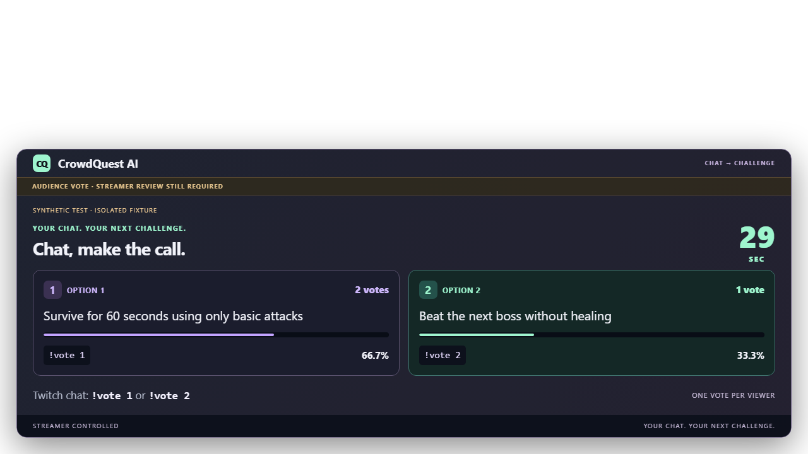

# CrowdQuest AI

**Your Chat Becomes the Game Director.**

AI-powered Twitch audience challenges with streamer approval, safe execution, and reliable Agent runtime.

## Current status

**The real Twitch → SQLite → owner-selected Dashboard → OBS display chain is evidenced.**
Phase 1 engineering acceptance is PASS: tested backend security hardening is loaded,
real EventSub/SQLite recovery is verified, and the user confirmed new owner login,
OBS pairing, rendering and preview expiry. Raw-image archival remains PARTIAL; supplied
visual evidence and explicit user observation are attributed separately.

Phase 2 installed-AIG integration and Phase 3 local engineering/CI are PASS.
The **genuine Phase 3 Twitch → real local model → explicit human Approval → independent
Authorization → AIG → actual OBS** single-Action session is now **PASS**, including
countdown expiry and no replay after OBS refresh. See the dated
[real session record](docs/PHASE3-REAL-ACCEPTANCE.md); earlier pre-activation reports
remain historical. Original live screenshot files were not exported to Git.

Phase 4 adds two-candidate crowd voting (`!vote 1` / `!vote 2`), exact winner-to-Plan
binding, owner-reported Completed/Failed/Skipped outcomes and a transparent broadcast
UI. Local qualification uses temporary SQLite and actual Chromium, with synthetic
chat/model/consent. **Phase 4 real Twitch voting/outcome/OBS acceptance is NOT_RUN.**
The running accepted Phase 3 instance and its built assets are preserved. Loading the
upgrade requires separate controlled-activation permission; follow the
[Phase 4 live runbook](docs/PHASE4-LIVE-RUNBOOK.md).

**Your Chat Becomes the Game Director.** Viewers propose, the community chooses,
the local model structures the challenge, and the streamer keeps the final say.
The four operations remain separate: Approve Plan, Admit Action, Authorize Action,
Execute Action. Voting never grants execution authority.



The public repository already existed with one README-only initial commit
(`639eabc8b6947a44048b220faea5fea4990587d1`, created 2026-10-25 UTC).
Phase 0 preserves that history; it does not fork or import another project's source.

Product flow: Twitch `!quest` → validated candidate → AI Plan → streamer preview and
explicit approval → independent AIG Authorization → durable overlay-job admission →
separate worker → OBS Browser Source. Admission and rendering have separate outcomes.

## Local Windows setup

Requirements: Python 3.13, uv and Node.js 22.12+ (CI uses 24; locally verified with 26.5).
In this repository:

```powershell
uv sync --locked --python 3.13
npm --prefix frontend ci
npm --prefix frontend run build
```

1. Register a dedicated application in the [Twitch Developer Console](https://dev.twitch.tv/console/apps).
   Twitch requires account verification and 2FA. Select a suitable category and Confidential
   client type. Set the exact redirect to **http://localhost:8000/auth/twitch/callback**.
2. Run `uv run python -m crowdquest.setup` in your terminal. Enter the Client ID, your
   **own confirmed test channel login**, and hidden Client Secret. Never paste secrets
   into chat or command arguments. Secrets/tokens go to Windows Credential Manager;
   non-secret config and SQLite use `%LOCALAPPDATA%\CrowdQuestAI\phase1` outside Git.
3. Run `uv run python -m crowdquest`. Open **http://localhost:8000**, click Connect Twitch,
   and complete legitimate Twitch consent yourself. Only `user:read:chat` is requested;
   the authenticated login must match the configured channel owner. Restart after setup
   changes. Use one server process; a private file lock enforces it.
4. Manually send `!quest Survive 60 seconds without healing` in that owned channel. Wait
   for a candidate and connected status. Missed/disconnected events are not replayed.
5. Open the overlay, match its code in the owner dashboard and click Pair. Wait for Ready.
   Select a candidate, then Preview selected. Nothing is automatically published.

Every preview says **DEVELOPMENT PREVIEW — NOT APPROVED / NOT EXECUTED** and expires in
60 seconds. Refresh/reconnect/restart do not replay old previews. Text is escaped.

For OBS: add a Browser Source using **http://localhost:8000/overlay**, size 1280×720.
Pair the code shown **inside OBS**, wait for Ready, then select a fresh preview. The
URL has no credential. Inspect the actual OBS canvas; a normal browser screenshot is
not OBS proof. Actual Phase 3 OBS observation passed in the recorded session; Phase 4 still needs its separate live gate.

Use the exact localhost URL; the server binds 127.0.0.1 and rejects other Host/Origin
values, LAN aliases and tunnels. No plaintext secret fallback. The consumer does not
load `.env` automatically. Optional process variable `CROWDQUEST_STATE_DIR` selects a
private directory outside the checkout. Configuration changes require restart.

## Phase 4 product setup

Use the existing local Ollama `phi4-mini:latest` and the production composition in the
[operator runbook](docs/PHASE3-RUNBOOK.md). Reuse a provisioned private profile; never
reset its identities, receipts or Unknown history. The default startup above retains
Phase 1 development previews for compatibility. A new installation should build the
frontend normally; an operator preserving a real running instance should use the
isolated build/test procedure below until controlled activation is authorized.

The [upgrade architecture](docs/PHASE4-COMPETITIVE-UPGRADE.md),
[acceptance evidence](docs/PHASE4-ACCEPTANCE.md), [live runbook](docs/PHASE4-LIVE-RUNBOOK.md),
[English 2:45 demo plan](docs/PHASE5-DEMO-STORYBOARD.md) and
[submission checklist](docs/PHASE5-SUBMISSION-CHECKLIST.md) describe the current scope.
Outcomes are streamer reports, not automatic gameplay recognition.

## Verification

Install Python 3.13 and [uv](https://docs.astral.sh/uv/), then from this repository:

```powershell
$env:UV_PROJECT_ENVIRONMENT = Join-Path (Get-Location) ".artifacts/phase4/venv"
uv sync --locked --python 3.13
uv lock --check --offline
uv pip check
uv run --locked python -I scripts/verify_baseline.py --environment $env:UV_PROJECT_ENVIRONMENT
uv run ruff check crowdquest tests
uv run ruff format --check crowdquest tests
uv run pytest -q
npm --prefix frontend run test
npm --prefix frontend run typecheck
npm --prefix frontend run lint
npm --prefix frontend run format:check
npm --prefix frontend run build:test
# Keep real frontend/dist intact; test fixture servers use the isolated build:
$env:CROWDQUEST_TEST_FRONTEND = Join-Path (Get-Location) ".artifacts/phase4/frontend"
uv run python -m playwright install chromium
uv run python -m tests.browser_e2e
uv run python -m tests.phase3_browser_e2e
uv run python -m tests.phase4_browser_e2e
git diff --check
```

These tests need no Twitch credentials. Browser E2E runs a temporary local server with
synthetic OAuth/EventSub and blocks external browser requests. It is not live Twitch
proof. After a genuine event, `uv run python -m crowdquest.evidence` reads persisted
counts, timestamps and hashed IDs without modifying state or exposing text/tokens.

AIG remains at full commit `bb8e8fb1234128613a750bee17967b225072bb14`, version `0.3.0`.
Its complete upstream instructions and Phase 0 checks are preserved. Python and frontend
dependencies are locked in `uv.lock` and `frontend/package-lock.json`.

## Competition and reuse

[Official rules](https://twitchcon-codex.devpost.com/rules) and
[FAQ/resources](https://twitchcon-codex.devpost.com/resources) were checked on
2026-10-27. Submissions are open. The rules' Pacific deadline converts to
**2026-11-03 11:00 NZDT** (2026-11-02 22:00 UTC).

AIG is a pre-existing MIT runtime, transparently reused as a dependency. Its eligibility
as the entrant's own pre-existing library is **UNVERIFIED**. Personal eligibility and
Devpost registration are also unconfirmed. See [originality and reuse](docs/ORIGINALITY_AND_REUSE.md)
and the [submission checklist](docs/SUBMISSION_CHECKLIST.md); this is not a claim of
fully verified competition eligibility. No organizer has been contacted.

## Project documents

- [Product requirements](docs/PRD.md)
- [Architecture and lifecycle](docs/ARCHITECTURE.md)
- [Security and threat model](docs/SECURITY_AND_THREAT_MODEL.md)
- [AIG integration contract](docs/AIG_INTEGRATION.md)
- [Twitch integration plan](docs/TWITCH_INTEGRATION.md)
- [Phases and gates](docs/PHASE_PLAN.md)
- [Acceptance criteria](docs/ACCEPTANCE_CRITERIA.md)
- [Decisions](docs/DECISIONS.md)
- [Phase 0 evidence](docs/PHASE0_EVIDENCE.md)
- [Phase 1 evidence and live-user steps](docs/PHASE1_EVIDENCE.md)
- [Phase 1 final engineering acceptance](docs/PHASE1-FINAL-ACCEPTANCE.md)

Read [AGENTS.md](AGENTS.md) before development. It preserves the entire authoritative
AIG consumer template and appends CrowdQuest constraints. No AIG core changes are allowed.

License: [MIT](LICENSE). The pre-existing dependency's original notice is retained in
[third-party notices](docs/THIRD_PARTY_NOTICES.md).
