# Proposed architecture

Status: design only. Python 3.13/FastAPI, React/TypeScript, SQLite and OBS Browser Source.
Initial deployment is one local host, one streamer/channel and one active runtime owner.

Phase 1 update: OAuth, intake and a separate manual preview are now implemented.
The production AI/AIG/queue diagram below remains future design. Phase 1 uses HTTP
polling, in-memory owner/overlay sessions, Windows Credential Manager and private
SQLite intake state. It creates no gate database, executable Plan, Action or grant.

```mermaid
flowchart LR
  V[Untrusted viewer chat] --> T[Twitch EventSub WebSocket]
  T --> I[Source checks / limits / durable dedup]
  I --> C[Candidate store]
  C --> P[Consumer ModelProvider / strict validation]
  P --> R[AIG persistent Run and exact Plan]
  R --> D[Authenticated streamer preview / Approve or Reject]
  D --> A[Action admission / independent Authorization / durable claim]
  A --> E[Trusted enqueue_overlay_challenge executor]
  E --> Q[Consumer queue / admission receipt]
  A --> G[AIG durable Action result]
  G --> F[Confirm matching successful admission]
  Q --> F
  F --> W[Separate overlay worker]
  W --> O[Read-only OBS Browser Source]
  O --> K[Rendering acknowledgement / outcome store]
```

## Components and trust boundaries

| Component | Owns | Cannot decide |
| --- | --- | --- |
| Twitch adapter | Token lifecycle, subscription/session, event validation | Approval or execution authority |
| Intake | Bounded parsing, durable event IDs, rate limits, candidate records | Trusted tool registration |
| Consumer provider | Domain prompt, bounded proposed Plan | Credentials, target/binding/scope, budget, grants |
| Streamer dashboard | Authenticated review and exact approve/reject request | Direct queue writes or runtime capabilities |
| AIG public runtime | Plan/Run/Approval, Action admission, Authorization, claim, result | Overlay rendering success |
| Consumer executor | One atomic queue/effect/receipt admission | Human consent or external rendering |
| Overlay worker | Eligible job ownership, delivery, separate rendering history | AIG execution/approval/authorization |
| Browser Source | Escaped display text, countdown, correlated acknowledgement | Control-plane mutations |

The public browser and chat boundary terminates at application authentication and
validation. AIG's local bearer capability is not Twitch login or production multi-user
authentication. All model output is data. The executor is trusted Python, not sandboxed.

## Exact approval and independent authorization

The backend supplies one reviewed startup binding and one closed flat scalar schema.
Consumer planning is validated by AIG before creating a persistent Run. An authenticated
channel owner reviews the exact current Plan and submits a version-bound decision.
After Approval, a trusted backend admits an Action; a distinct policy checks its frozen
identity, subject, operation, channel, risk and current host authorization conditions.
Only then may the public gateway durably claim and call the executor. Do not expose
AIG's demo UI/routes as the application's authentication system.

The backend stores candidate-to-Run and Action-to-receipt correlations; it does not
reimplement AIG's Run/Action state machine, CAS, owner fence or Approval digest.
Default adapter budget is five seconds. Provider planning occurs before execution;
overlay rendering occurs after execution in a separate worker.

## Persistence and lifecycle

All stores are private and outside the checkout. Provision identity once, fail if it
does not match, retain it on restart, and keep one process as runtime owner.

- `application.sqlite3`: event delivery/message IDs, candidates, dashboard/audit
  correlations and application session references. Never log full tokens or raw prompts.
- `gate.sqlite3`: exclusively managed by AIG through its public runtime.
- `overlay.sqlite3`: consumer binding identity, effect key, payload digest, immutable
  admission receipt, job, worker ownership and rendering acknowledgements.
- Credential store: Twitch secrets, runtime capability, session and overlay credentials
  have separate purposes/identities. Worker and model receive no approval credentials.

The admission executor uses one short transaction to bind an AIG effect key to the
full payload and a unique job/receipt. Same key/payload returns the original receipt;
same key/different payload is a confirmed conflict, never an overwrite. Read back
and validate committed identity and receipt within the execution budget.

Job lifecycle (application states, not new AIG states):

`ADMITTED_PENDING_CONFIRMATION → ELIGIBLE → CLAIMED → SENT → RENDER_ACKNOWLEDGED → COMPLETED`

Terminal alternatives: proven undispatched `EXPIRED`/`RENDER_FAILED`, or uncertain
`RENDER_UNKNOWN`. Claim and dispatch must be fenced per channel/job/browser session;
one active challenge is allowed per channel. Persist a dispatch marker before sending.
An acknowledgement includes job, receipt correlation and the current delivery session.
An initial rendered acknowledgement proves display initialization, not completion of
the countdown or successful gameplay. Browser reload must not restart the challenge.

**Critical release gate:** an admitted job is ineligible until the backend verifies
the corresponding durable AIG Action is `Succeeded` and its receipt matches the job.
Use public `runtime.gateway.get(action_id, principal)`, never query/mutate AIG tables
directly. If AIG finish is lost, Unknown, interrupted or unavailable, quarantine the job.
Startup may read durable confirmed success to restore eligibility for a never-dispatched
job. That is read-only confirmation, not execution replay or Unknown reconciliation.

## Failures

| Failure | Required behavior |
| --- | --- |
| Invalid/duplicate/stale chat | Reject or suppress before creating a candidate |
| Provider refusal/invalid output | Record generation failure; no approval or effect |
| Reject/stale approval | No Action execution; obtain new review if Plan changes |
| Missing grant/binding mismatch | AIG denial; no queue write |
| SQLite failure proven before effect | Confirmed no-effect failure only with evidence |
| Admission commit/ack or AIG finish uncertain | Terminal AIG Unknown; quarantine job; no retry |
| Worker crash before known dispatch | Recover only a proven undispatched fenced job |
| Send/ack ambiguity, renderer disconnect | Separate RENDER_UNKNOWN; no automatic resend |
| Reconnect/startup | Preserve IDs, history, fences and active countdown; no blind replay |

No transaction spans AIG and the asynchronous worker. No universal exactly-once
remote rendering guarantee is asserted. The gate, worker and browser each require
their own failure evidence. See [security](SECURITY_AND_THREAT_MODEL.md).
