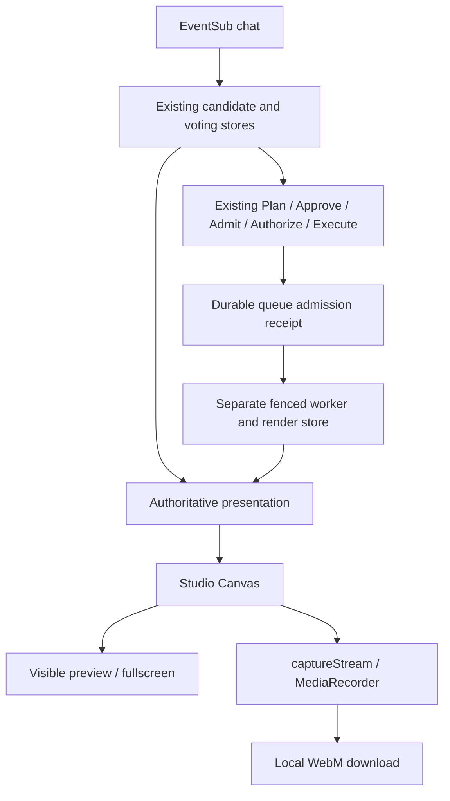

# Phase 4.5 — OBS-free Broadcast Studio

Open **http://localhost:8000/broadcast-studio** after signing into the existing
owner Dashboard. No OBS installation, process, password, WebSocket server or Browser
Source is required. The Studio presents and records CrowdQuest; it does not stream.

## One presentation, one recording surface



`studio-canvas.ts` draws all presentation text, vote bars, totals, chosen-by-chat
indicator, challenge countdown and persisted outcome on the same Canvas used by
`captureStream(30)`. DOM status panels and credentials are outside the recording.
Default resolution is 1920×1080; 1280×720 uses the same layout and renderer.

The existing read-only render/current path is shared rather than replaced. The
owner-only `/api/studio/connect`, `/current`, `/ack` and `/status` routes add a
separate HttpOnly display cookie; they do not create Plans or admit Actions.
Normal app startup does not import the optional OBS SDK or read its credentials.

| Scene | Authoritative source |
| --- | --- |
| Waiting | No active presentation, expired challenge or disconnected backend. |
| Voting | Frozen choices, vote totals, round state/deadline and winner from existing voting storage. |
| Challenge Active | An eligible worker delivery after confirmed AIG success; bounded title, description, difficulty and remaining time. Development previews retain their warning. |
| Challenge Result | Existing persisted Completed / Failed / Skipped outcome during its bounded presentation window. |

**Follow live state** is the recording mode. Other scene buttons are local layout
previews; they show only matching current content, cannot create votes or challenges,
and disable recording. An expired historical result may appear as status text but
is never republished. Server time is anchored conservatively to request-start
monotonic time; expiry clears content even if polling is delayed. Reconnection and
reload use existing no-replay fencing. A Studio ACK is browser evidence, never OBS
evidence or proof of gameplay completion.

## Recording and export

1. Sign in at `/` as the configured channel owner, then open `/broadcast-studio`.
   OAuth remains **user:read:chat**. No OBS pairing is needed for Studio.
2. Wait for Backend connected and a rendered preview. Choose resolution and a safe
   `.webm` filename; leave Follow live state selected.
3. Click Start Recording once. Keep this tab visible. Click Stop Recording once
   after the desired 30–180 seconds, or let the 180-second limit stop it.
4. Wait for **Finalized · playback verified**. Download the file before refreshing
   or closing. Play the file using the provided video controls and retain it locally.

VP8 WebM is preferred, then VP9 or generic WebM if supported. Recording is silent:
no microphone, camera, screen, system audio or OS permission is requested. Output
is browser-local; the browser chooses Downloads. For engineering acceptance, files
are copied without altering originals to `.artifacts/phase45-browser/`. There is no
backend upload, arbitrary file-write, cloud storage or external upload endpoint.

Bounds: 180 seconds, 64 MiB of accepted chunks per file, three files per page.
Filenames reject separators, traversal, alternate extensions and duplicates within
the page. Start/stop guards prevent overlapping recorders. Hidden tabs or pagehide
interrupt recording; a recovered file is labeled Interrupted, even if decodable.
Start/stop errors and missing callbacks have bounded watchdogs and no automatic
restart. Unsupported recording leaves live preview available.

Files and Blob URLs live in page memory until teardown; a refresh cannot recover
unfinalized chunks. A before-unload warning protects active/undownloaded work when
the browser permits it. A session marker reports interrupted recording on reload,
which always starts Idle. Downloading is essential; this is not durable browser
storage. OS/browser crashes and exhausted memory can still lose an unsaved recording.

Finalization adds missing Duration metadata using pinned
`@fix-webm-duration/fix==1.0.1`, applied only before the first media Cluster. The
original Cluster tail is preserved byte-for-byte, avoiding the dependency parser's
unknown-size Cluster nesting problem. The root Segment stays streaming-sized.
Success requires actual video playback, expected resolution and finite duration
within one second of elapsed capture. A failed playback file is retained explicitly
unverified. Metadata-finalization failure reports an error rather than success.

30 FPS is a target, not a guarantee: browser scheduling and Canvas/encoder load can
drop frames. Final Chromium qualification averaged 25.41 FPS; earlier actual IAB
recording averaged about 29.27 FPS. Lower resolution may help. No audio or MP4 is
claimed as implemented. An optional external conversion, after preserving WebM, is:

```powershell
ffmpeg -n -i input.webm -r 30 -fps_mode cfr -c:v libx264 -pix_fmt yuv420p -an -movflags +faststart output.mp4
ffmpeg -v error -xerror -i output.mp4 -f null -
```

Inspect and play the converted file independently. CFR conversion can duplicate or
drop frames; it does not improve original capture rate. Never rename WebM to MP4.

## Local security and unchanged safety gates

The launcher binds 127.0.0.1 with proxy headers disabled. Studio also checks the actual
socket peer is loopback. Existing exact localhost Host/Origin, Fetch Metadata,
authenticated owner session and CSRF protections apply. Display credentials are
HttpOnly, SameSite=Strict and scoped to `/api/studio`; connect is owner/CSRF gated,
bounded and idempotent. ACK requires the owner session, CSRF and matching delivery
and view identities. No runtime capability, worker token, OBS password or Twitch
token is sent to Studio. CSP permits same-origin scripts/styles and local Blob media,
not arbitrary scripts or remote recording destinations. Text is drawn as text.

The installed AIG 0.3.0 full commit pin, single `enqueue_overlay_challenge/1` tool,
five-second budget and separate Approval/Admission/Authorization/Execution are
unchanged. Recorder controls never invoke them. Unknown results remain terminal;
no recovery replay or replacement Action is created by Studio. This is a local
single-user product, not protection against a malicious user controlling the OS.

## Build and qualification

Use an isolated environment/build to preserve a running installation:

```powershell
$env:UV_PROJECT_ENVIRONMENT = "$PWD/.artifacts/phase45/venv"
uv sync --locked --python 3.13
uv run python -I scripts/verify_baseline.py --environment $env:UV_PROJECT_ENVIRONMENT
uv run pytest -q
npm --prefix frontend ci
npm --prefix frontend run test
npm --prefix frontend run lint
npm --prefix frontend run format:check
npm --prefix frontend run build:studio
$env:CROWDQUEST_TEST_FRONTEND = "$PWD/.artifacts/phase45-browser/frontend"
uv run python -m tests.browser_e2e
uv run python -m tests.phase3_browser_e2e
uv run python -m tests.phase4_browser_e2e
uv run python -m tests.obs_browser_e2e
uv run python -m tests.studio_browser_e2e --output-dir .artifacts/phase45-browser/new-evidence
```

The last command uses real Canvas recording/playback in Chromium, temporary SQLite,
installed AIG, a separate worker and **synthetic** OAuth/chat/model/consent. It is not
real Twitch or human approval evidence. Optional `--ffmpeg <path>` additionally checks
full decoding, duration, frame count and invalid Cluster warnings. Production-only
installation `uv sync --locked --no-dev` omits the OBS SDK; a fresh normal frontend
build plus existing application/operator startup is sufficient. Do not reset or
re-provision an existing private AIG profile to enable Studio.

For a fresh development installation after private Twitch setup:

```powershell
uv sync --locked --no-dev --python 3.13
npm --prefix frontend ci
npm --prefix frontend run build
uv run --locked --no-dev python -m crowdquest
```

This retains Phase 1 development previews; it does not automatically enable the
production AIG composition. Existing production installations retain their private
profile and separate worker startup from [the operator runbook](PHASE3-RUNBOOK.md),
using Studio instead of its optional OBS display steps. Do not run a second backend
against an active profile or rebuild live assets during pending work.

## Rollback

Download and preserve browser recordings first. Inspect durable Actions/jobs and
stop only the identified CrowdQuest backend/worker during an authorized safe window;
do not interrupt pending/ambiguous work or auto-replay it. Return to the previously
qualified source, locked environment and preserved frontend assets. Keep real SQLite,
private identities, receipts and credentials intact: Studio adds no schema migration
and rollback does not require restoring or clearing a database. Return to the prior
display workflow only if its own prerequisites are available; it may require OBS.
An interrupted historical Action must not be re-executed to demonstrate rollback.

## Optional OBS compatibility and removal

The preserved OBS Admin prototype is disabled by default. Only operators choosing
that compatibility path install `uv sync --locked --extra obs` and use `--obs-admin`,
or the separate OBS-only launcher. See [optional Admin](PHASE45-OBS-ADMIN.md).
It is outside AIG and not required for core startup, rendering or recording.

CrowdQuest's Studio path can operate with OBS removed. Actual uninstallation is a
separate user action and was NOT_RUN; preserve any personal OBS scenes/recordings
first. IAB final-build reacceptance currently remains PARTIAL as described in the
[acceptance report](PHASE45-BROADCAST-STUDIO-ACCEPTANCE.md). No OBS setup is requested.

API references: [Canvas captureStream](https://developer.mozilla.org/en-US/docs/Web/API/HTMLCanvasElement/captureStream),
[MediaRecorder](https://developer.mozilla.org/en-US/docs/Web/API/MediaRecorder),
[duration metadata dependency](https://github.com/yusitnikov/fix-webm-duration).
